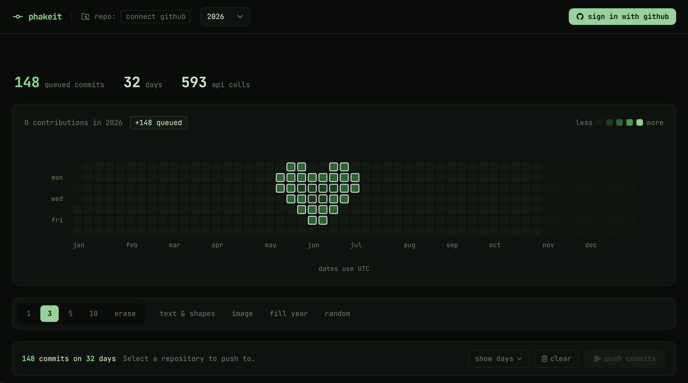
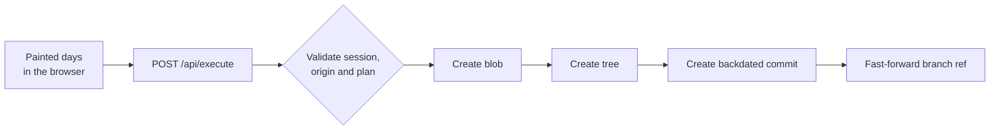

<div align="center">

# phakeit

**Paint your GitHub contribution graph.**<br>
Draw on a heatmap, and phakeit creates the backdated commits for you through the GitHub API. No local git required.

[**Live demo: phakeit.vercel.app**](https://phakeit.vercel.app)


<br>



</div>

## Contents

- [Features](#features)
- [How it works](#how-it-works)
- [Quick start](#quick-start)
- [Configuration](#configuration)
- [Deploying](#deploying)
- [Security](#security)
- [Limits and known tradeoffs](#limits-and-known-tradeoffs)
- [Project structure](#project-structure)
- [Responsible use](#responsible-use)

## Features

- **Real graph.** Your actual contributions for any year since 2008, loaded from the GitHub GraphQL API.
- **Paint by hand.** Click or drag to queue days at 1, 3, 5 or 10 commits. Right-click or use the erase tool to remove them.
- **Text and shapes.** Render words with a built-in 5x7 pixel font, or stamp preset shapes (heart, star, smiley and more).
- **Image to graph.** Drop in an image and it is converted to commit intensities in the browser. Nothing is uploaded.
- **Fill year and random.** Fill a whole year with organic daily activity, or scatter a set number of commits across random days.
- **Year summary.** Current and longest streak, active days, busiest day and monthly totals for the selected year.
- **Safe execution.** A confirm step shows the target repository and commit count before anything is pushed. Runs can be stopped part way and keep the commits already made.
- **Works as a guest.** Paint and plan without signing in. Sign in with GitHub only when you are ready to push.

## How it works

GitHub's contribution graph is based on a commit's author date, not the time it was pushed. For each painted day the server builds a commit with a custom `author.date` and `committer.date`, chained on top of the default branch.



Each commit appends a line to `contributions.md`. The branch ref is advanced every 50 commits and again at the end. It is never force-pushed.

For the graph to update on GitHub:

- Commits must land on the repository's **default branch**.
- The repository must **not be a fork** (fork commits do not count).
- The author email must be **verified** on your account. The primary verified email is used.
- GitHub can take a few minutes to refresh the graph.

## Quick start

Requirements: Node.js 20 or newer and a GitHub account.

1. **Create a GitHub OAuth App** at <https://github.com/settings/developers>.

   | Field | Value |
   | --- | --- |
   | Homepage URL | `http://localhost:3000` |
   | Authorization callback URL | `http://localhost:3000/api/auth/github/callback` |

2. **Create `.env.local`** in the project root (see [Configuration](#configuration)).

3. **Install and run:**

   ```bash
   npm install
   npm run dev
   ```

4. Open <http://localhost:3000>. Try it as a guest first, then sign in to push.

For a first run, use a throwaway repository and a small plan.

## Configuration

| Variable | Required | Description |
| --- | --- | --- |
| `GITHUB_CLIENT_ID` | yes | Client ID of your GitHub OAuth App. |
| `GITHUB_CLIENT_SECRET` | yes | Client secret of the OAuth App. Server only. |
| `NEXT_PUBLIC_BASE_URL` | production | Exact public origin, for example `https://phakeit.vercel.app`. Used for the OAuth redirect URI and the CSRF origin check. Defaults to `http://localhost:3000` in development. |
| `SESSION_SECRET` | yes | At least 32 characters. Encrypts the session cookie. |

Generate a session secret:

```bash
node -e "console.log(require('crypto').randomBytes(32).toString('base64url'))"
```

Scripts: `npm run dev`, `npm run build`, `npm run start`, `npm run lint`.

## Deploying

1. Create a **separate production OAuth App** with your domain as the homepage and `https://<your-domain>/api/auth/github/callback` (for the live site: `https://phakeit.vercel.app/api/auth/github/callback`) as the callback URL.
2. Set the four environment variables on your host (for example in the Vercel project settings). Use a new `SESSION_SECRET`, not the one from development.
3. Serve the site over HTTPS. The `__Host-` session cookie and the HSTS header require it.
4. After deploying, test with a throwaway repository: sign in, push a few commits, then sign out.

## Security

| Area | What is done |
| --- | --- |
| Session | The GitHub token is encrypted with AES-256-GCM (key derived from `SESSION_SECRET`) inside an `httpOnly`, `SameSite=Lax`, `Secure` cookie, `__Host-` prefixed in production. It expires after 8 hours and the browser never sees the token. |
| OAuth | Authorization code flow with a random `state` and PKCE (S256), held in a short-lived sealed cookie and compared in constant time. The redirect URI comes from `NEXT_PUBLIC_BASE_URL`, never from the Host header. |
| Sign out | POST only, origin checked, and the token is revoked at GitHub. |
| CSRF | State-changing routes require a matching `Origin` header and a JSON content type. |
| Execution limits | The server derives owner, branch and author itself. The target must be a repository you own that is not a fork or archived. Plans are validated: real dates between 2008 and today, 1 to 20 commits per day, at most 366 days and 500 commits per run. One run per user at a time, with a per-user request rate limit. |
| Git safety | Branch updates are fast-forward only. Closing the tab stops the run and keeps the commits already made. |
| Browser hardening | Nonce-based CSP with `strict-dynamic`, HSTS, `frame-ancestors 'none'`, `nosniff`, COOP and CORP, strict referrer and permissions policies, and `no-store` on API responses. |
| Errors | Clients receive generic messages and details stay in server logs. Auth error codes in the URL map to fixed messages. |
| Data | Nothing is stored server side. Painted days live in the browser until you push or leave. |

## Limits and known tradeoffs

- **OAuth scope.** GitHub OAuth Apps can only grant the broad `repo` scope for private repositories, so a leaked token would expose private code. Use a dedicated repository, sign out when done (this revokes the token), or change the scope to `public_repo` in `app/api/auth/github/route.ts` to restrict access to public repositories.
- **Rate limiting.** The limiter in `lib/rate-limit.ts` is in memory, so it only holds on a single server instance. On serverless or multi-instance hosting, back it with a shared store such as Redis, Vercel KV or Upstash.
- **Run time.** Each commit takes three GitHub API calls. Large runs can exceed your host's function time limit. Lower `MAX_COMMITS_PER_RUN` in `lib/plan-validation.ts` if needed. Commits made before a cutoff are kept.
- **Retrying.** If a run fails part way, some commits may already be pushed. Check the repository before running again.

## Project structure

```
app/                     pages and API routes (auth, execute, repos, me)
proxy.ts                 per-request CSP nonce and headers
components/
  graph/                 heatmap, cells, labels, year summary
  tools/                 paint, text and shapes, image, fill, random
  execution/             repo selector, commit queue, push modal
lib/
  session.ts             sealed session cookie
  oauth.ts               state and PKCE handling
  security.ts            origin and content-type checks
  rate-limit.ts          rate limit and single-run lock
  plan-validation.ts     server-side plan checks and limits
  commit-executor.ts     Git Data API pipeline
  github-api.ts          GitHub REST and GraphQL helpers
  core/                  date mapping, 5x7 font, patterns, insights
store/graph-store.ts     painted days, keyed by UTC date
```

Built with Next.js (App Router), React, TypeScript, Tailwind CSS, Zustand, shadcn/ui and Octokit.

## Responsible use

This is a personal hobby project, built for fun and to experiment with the GitHub API. I don't encourage or support faking a public profile, and I have never used this tool on my own main account. Backdated commits are real commits with the dates you choose, and they stay visible in the repository's history. Please don't use it to misrepresent your work to employers or anyone else. The app shows this notice every time it opens.
